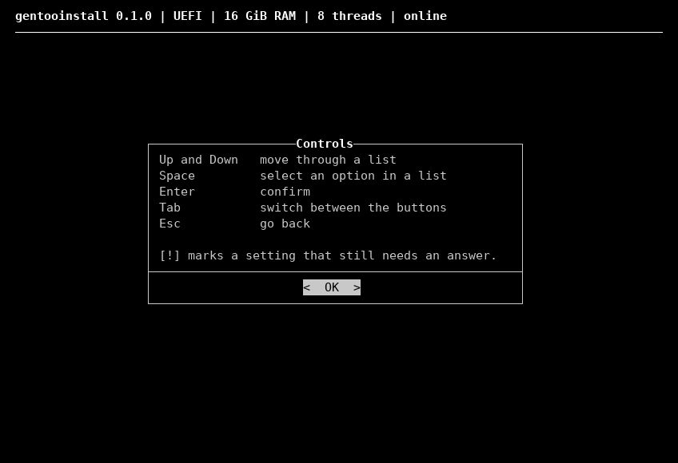

# gentooinstall

A guided installer for Gentoo Linux, like Arch's `archinstall`. You answer a few questions in a menu, and it installs Gentoo the way the [AMD64 Handbook](https://wiki.gentoo.org/wiki/Handbook:AMD64) does, using prebuilt packages wherever it can.



**It erases the whole disk you pick**, unless you install into its free space, next to Windows or another system (see [Next to Windows](#next-to-windows)).

Status: early. Tested in virtual machines and on one laptop.

## What you need

- A 64-bit PC that boots in UEFI mode
- A USB stick with the [Gentoo minimal install ISO](https://www.gentoo.org/downloads/)
- Internet: Ethernet, or Wi-Fi with WPA2

## Install

1. Boot the USB stick in UEFI mode.
2. Connect to the internet. Ethernet works on its own. For Wi-Fi, run `nmtui`.
3. Download and start the installer:

   ```sh
   git clone https://github.com/w0x7y/gentooinstall
   cd gentooinstall
   ./gentooinstall
   ```

4. Go through the menu: arrows move, Space selects, Enter confirms, Esc goes back. Every setting marked `[!]` needs an answer. Then start the install.
5. When it's done, remove the USB stick and reboot. `first-steps.txt` in your home folder says what to do next. If you kept Secure Boot on, note the code the last screen shows: you type it once at the first start, on a blue MokManager screen.

## What you can choose

- The whole disk, or its free space beside another system
- OpenRC or systemd
- ext4, xfs or btrfs, with optional disk encryption, and on ext4 or xfs /home on a partition of its own. On btrfs, every update starts with a snapshot you can roll back to with `rollback`
- Swap in compressed RAM, a swap file, or a swap file big enough to hibernate
- systemd-boot, GRUB or Limine
- Keep Secure Boot on (with systemd-boot), or turn it off
- A desktop: KDE Plasma, GNOME, Xfce, Cinnamon or Budgie
- Or a window manager: i3, Sway, Hyprland, niri, MangoWM, dwm or dwl
- Or no desktop at all
- A login screen: graphical, text (tuigreet), or none
- Flatpak with Flathub, for apps like Steam or Spotify without compiling
- Printing, fingerprint login, and the newest kernel for very new hardware
- On laptops with Intel or AMD graphics plus an NVIDIA GPU: `prime-run` to use the NVIDIA GPU for chosen apps, which powers off otherwise
- Extra packages, picked from a searchable list

Budgie, Hyprland, niri and MangoWM come from community overlays that Gentoo doesn't review, and they build from source.

## Next to Windows

1. In Windows, open Disk Management and shrink its partition to leave at least 22,000 MB free (42,000 MB with a desktop).
2. If Windows uses BitLocker or device encryption, set **Secure Boot** to **Keep it on** in the installer. Turning Secure Boot off makes Windows ask for its recovery key; if you do, save the key first (https://aka.ms/myrecoverykey).
3. In the installer, set **Install to** to **Free space on the disk**. Nothing else on the disk is changed.

Windows then appears in the boot menu, and the clock stays right in both systems. With BitLocker, start Windows from the firmware boot menu instead (F12, F11 or Esc at power-on), or it asks for the recovery key each time.

## If something goes wrong

When a step fails, you can retry it, read the log, or open a shell to fix things.

If you stop the install or reboot, run the installer again with `--resume` and it continues where it stopped. After a reboot, connect and download it again first (steps 2 and 3).

If the installed system stops starting later, start the USB stick, download the installer again, and run `./gentooinstall --rescue`. It unlocks and mounts the system and opens a shell in it; on btrfs, `rollback` there undoes an update.

Everything it runs is logged in `/tmp/gentooinstall/`, and copied to `/var/log/gentooinstall/` on the new system. Passwords never appear in the logs.

## Options

| Option | What it does |
|---|---|
| `--resume` | Continue a stopped install |
| `--rescue` | Unlock and mount an installed system and open a shell in it, to fix it or roll back |
| `--dry-run` | Ask the questions, then only print what it would do |
| `--explain` | Explain each step as it runs |
| `--no-tui` | Plain text prompts instead of menus |

`./gentooinstall --help` lists them all, including unattended installs with `--config`, `--secrets` and `--yes`.

## Development

`SPEC.md` describes what the installer does, and `ARCHITECTURE.md` how the code fits together. Tests never run as root or change your system:

```sh
tests/bootstrap.sh   # once: downloads shellcheck and bats
tests/run.sh         # runs every test
```

## License

MIT, see [LICENSE](LICENSE).
